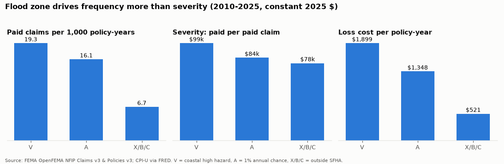
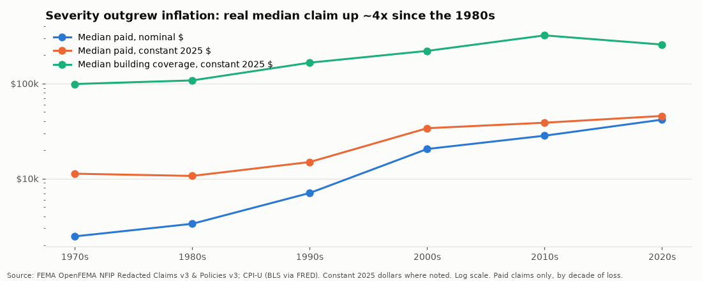
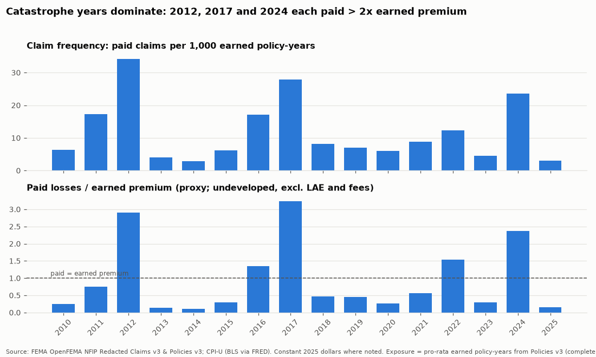
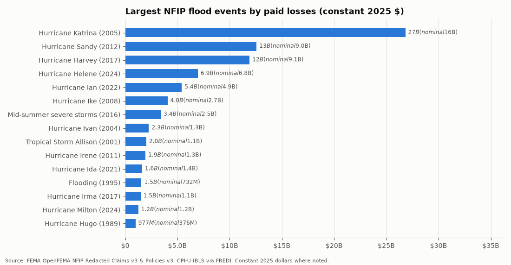
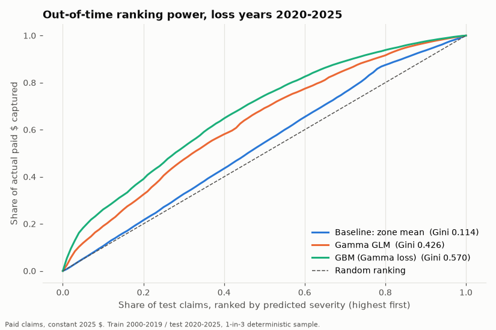
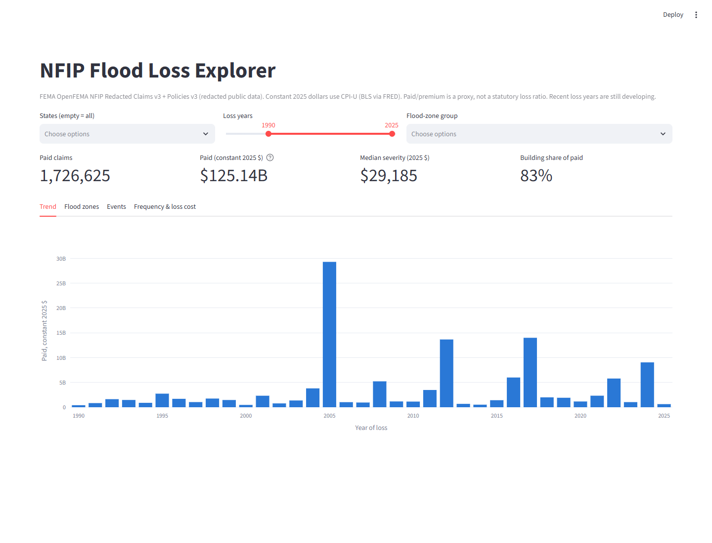
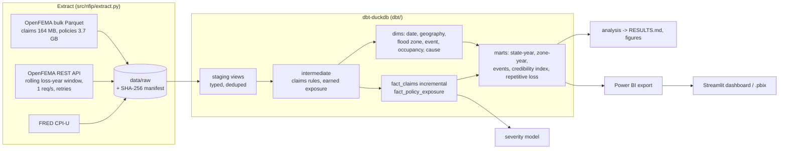
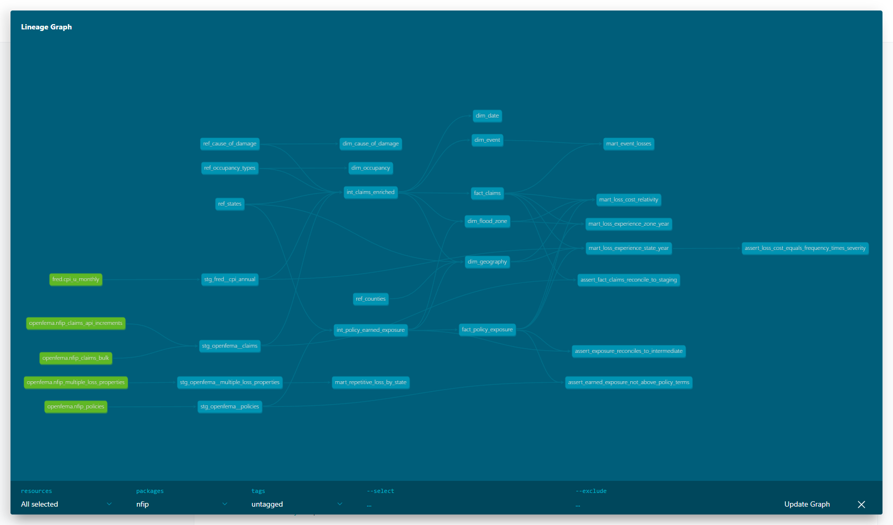

# NFIP Flood-Claims Analytics Warehouse

**A tested dbt + DuckDB star schema over FEMA's 2.7M real NFIP flood claims and 74.7M policy
records, with earned exposure, inflation-adjusted loss trends, a credibility-weighted loss-cost
index, an out-of-time-validated severity model, an interactive dashboard, and a Power BI-ready
export.**

> **Real data, not synthetic.** All numbers come from FEMA OpenFEMA *NFIP Redacted Claims v3* and
> *NFIP Redacted Policies v3* (retrieved 2026-10-10) and BLS CPI-U via FRED. Every number below is
> produced by code in this repo; the command that regenerates it is given next to it.

[](https://github.com/AwpDemon/nfip-flood-claims-analytics/actions/workflows/ci.yml)

---

## Results

Regenerate everything below with `python -m nfip analyze` (writes [`docs/RESULTS.md`](docs/RESULTS.md))
and `python -m nfip model`. Dollars are constant 2025 dollars (CPI-U) unless marked nominal.

| | |
|---|---|
| Claims modeled | **2,725,989** (2,117,326 paid), loss years 1978-2026 |
| Paid losses | **$89.9B nominal = $136.0B in 2025 dollars** |
| Earned exposure | **66.1M policy-years** (2010-2025, pro-rata from 74.7M policy-term rows) |
| Warehouse | 19 dbt models (6 dims, 2 facts, 5 marts), 4 seeds, **87 data tests**, full build ~2.5 min on a laptop |
| Tests | 26 pytest tests (unit + end-to-end `dbt build` on a real-data fixture) in CI |

### Three findings

**1. Outside the high-risk zones is a quarter of the losses.** Zones X/B/C/D (outside the Special
Flood Hazard Area, where flood insurance is optional) held **45.3% of earned policy-years** and
produced **25.4% of paid claims and 24.1% of paid dollars** in 2010-2025. The zone gap is almost all
**frequency**, not severity:

| Zone group (2010-2025) | Earned policy-years | Paid claims / 1,000 | Severity | Loss cost / policy-year | Paid / premium (proxy) |
|---|---|---|---|---|---|
| V (coastal high hazard) | 0.91M | 19.3 | $98,533 | $1,899 | 0.55 |
| A (1% annual chance) | 35.15M | 16.1 | $83,805 | $1,348 | 1.03 |
| X/B/C (moderate-minimal) | 29.85M | 6.7 | $78,313 | $521 | 0.79 |



**2. Severity is outgrowing inflation by ~2.8% a year.** The median paid claim rose from ~$10.7k
(1980s) to ~$45.5k (2020s) *after* CPI adjustment. A Gamma GLM controlling for zone, coverage,
occupancy and building characteristics estimates a **+2.77%/year real severity trend** (2000-2019).



**3. Results are made in a few catastrophe years.** National paid / earned premium (a proxy, see
limitations) is 0.94 over 2010-2025, but 2012 (Sandy, 2.91), 2016 (1.35), 2017 (Harvey, 3.24), 2022
(Ian, 1.54) and 2024 (Helene/Milton, 2.37) exceed 1.0 while quiet years run 0.11-0.56. The top 5
named events carry **46.8%** of all real paid dollars since 1978; the top 1% of paid claims carry 11.4%.




More: [state loss cost](docs/figures/state_loss_cost.png) (NJ and NY run 3.0-3.1x the national loss
cost per policy-year), [severity distribution](docs/figures/severity_distribution.png),
[building vs contents](docs/figures/building_vs_contents.png) (82.3% of paid is building),
[repetitive loss](docs/figures/repetitive_loss_states.png) (240,651 multiple-loss properties, 5.5%
mitigated), [annual losses](docs/figures/annual_paid_real.png). Full tables:
[`docs/RESULTS.md`](docs/RESULTS.md). One-page business summary:
[**Underwriter memo**](docs/UNDERWRITER_MEMO.md).

### Severity model (out-of-time: train loss years 2000-2019, test 2020-2025)

Target: building + contents paid per paid claim (2025 $). Features are only what an underwriter
knows before a loss. Deterministic 1-in-3 sample: 369,832 train / 72,931 test claims.
`python -m nfip model` (~5 min) -> [`docs/results/model_metrics.csv`](docs/results/model_metrics.csv).

| Model | Normalized Gini | Mean Gamma deviance | A/E | Top-decile lift |
|---|---|---|---|---|
| Baseline: zone-mean severity | 0.114 | 1.816 | 1.11 | 1.08 |
| Gamma GLM (log link) | 0.426 | 1.665 | 1.26 | 1.91 |
| Gamma GLM + calendar-year trend | 0.436 | 1.582 | **0.95** | 1.93 |
| Gradient boosting, Gamma loss | **0.570** | **1.566** | 1.54 | 2.61 |
| GBM + post-loss facts (water depth, cause, event) - *triage only, not pricing* | 0.631 | 1.461 | 1.54 | 2.77 |

Honest read: underwriting-time features rank severity well (GLM ~4x the baseline Gini, GBM higher),
but **level is the hard part** - untrended models under-predict 2020-2025 by 26-54%. The trend term
fixes the overall level (A/E 0.95) yet year-by-year A/E still swings 0.50-1.43 with the storm mix
(Ian, Helene), which no policy-level feature can know. Two consecutive full runs reproduced these metrics exactly.



### Data quality: tests that caught real problems

* **12.2% of claims (333,366) carry `originalConstructionDate = 1492-10-12`** - Columbus Day used as
  an "unknown" placeholder. Caught by an `in_range` test on building age; nulled and flagged.
* **The CPI base year silently vanished**: BLS published no October 2025 CPI (shutdown), so a strict
  12-month average dropped 2025 and nulled every real-dollar figure. Now >= 11 months, with
  `not_null` + `in_range` tests guarding it.
* `asOfDate` is a snapshot stamp on every row, not a change timestamp - so incremental loads use a
  rolling loss-year window instead.

Details, thresholds and completeness by decade: [`docs/DATA_QUALITY.md`](docs/DATA_QUALITY.md).

### Dashboard

Streamlit app over the same exported star schema (`streamlit run app/dashboard.py`):



Power BI: no account was created; `python -m nfip export-powerbi` writes the star schema
(Parquet/CSV) and [`docs/POWERBI_GUIDE.md`](docs/POWERBI_GUIDE.md) gives the relationships and
DAX measures to build the .pbix.

---

## Architecture





Browse the generated dbt docs (models, columns, tests, lineage): open
[`docs/dbt-docs/index.html`](docs/dbt-docs/index.html) locally.

**Star schema.** `fact_claims` (grain: one claim) and `fact_policy_exposure` (grain: county x
calendar year x rated zone x occupancy) share four conformed dimensions, which is what makes
"claims per earned policy-year by state and zone" possible on redacted data where a claim cannot
be joined to its policy.

### Production path (designed, not deployed)

No cloud accounts were created for this project. The production version is the same dbt project on
a different adapter: the extract lands Parquet in **S3** (`s3://<bucket>/openfema/<dataset>/...`),
**Snowflake** reads it through an external stage / `COPY INTO`, and `dbt build --target prod`
runs with `dbt-snowflake` on a monthly schedule matching FEMA's refresh (Airflow, Dagster or dbt
Cloud). The incremental `fact_claims` (delete+insert on a 3-loss-year window) is what keeps
Snowflake credits low there; on DuckDB the full build is only ~2.5 minutes. Cost controls: X-Small
warehouse, auto-suspend 60 s, CI against DuckDB so pull requests cost nothing.

---

## Run it

```bash
python -m venv .venv && . .venv/Scripts/activate      # Windows Git Bash; use .venv/bin/activate on Linux/macOS
pip install -r requirements.txt && pip install -e . --no-deps
python -m nfip extract-bulk && python -m nfip extract-increment --lookback 2   # ~3.9 GB download, polite client
python -m nfip dbt build                                                       # seeds, 19 models, 87 tests
python -m nfip analyze && python -m nfip quality && python -m nfip model && python -m nfip export-powerbi
```

Then `streamlit run app/dashboard.py`. Without downloading anything, `pytest -q` builds the whole
warehouse from the committed real-data fixture (`tests/fixtures/raw`, ~0.9 MB). DuckDB memory is
capped at 4 GB (`NFIP_DUCKDB_MEMORY`); the 74.7M-row policy file is streamed, never loaded into
pandas. `deploy/` holds a Dockerfile + compose file for the read-only dashboard (not deployed).

```
src/nfip/        extract, analysis, model, metrics, quality report, Power BI export, CLI
dbt/             sources, staging, intermediate, marts, macros, generic + singular tests, seeds
app/             Streamlit dashboard
tests/           pytest + real-data fixture
docs/            figures, RESULTS.md, DATA_QUALITY.md, UNDERWRITER_MEMO.md, POWERBI_GUIDE.md,
                 INTERVIEW_GUIDE.md, dbt-docs/
scripts/         fixture builder, reference-seed builder, dbt docs publisher
```

---

## Data sources and licenses

| Source | Used for | Terms |
|---|---|---|
| FEMA OpenFEMA [NFIP Redacted Claims v3](https://www.fema.gov/openfema-data-page/nfip-redacted-claims-v3) (`/api/open/v3/NfipClaims`, bulk `NfipClaimsV3.parquet`) | claims | [OpenFEMA terms](https://www.fema.gov/about/openfema/terms-conditions) |
| FEMA OpenFEMA [NFIP Redacted Policies v3](https://www.fema.gov/openfema-data-page/nfip-redacted-policies-v3) (bulk `NfipPoliciesV3.parquet`) | earned exposure, premium | same |
| FEMA OpenFEMA [NFIP Multiple Loss Properties v1](https://www.fema.gov/openfema-data-page/nfip-multiple-loss-properties-v1) | repetitive-loss exhibit | same |
| U.S. Bureau of Labor Statistics, CPI-U All Items, U.S. City Average [CPIAUCSL], retrieved from FRED, Federal Reserve Bank of St. Louis, https://fred.stlouisfed.org/series/CPIAUCSL, 2026-10-10 | constant dollars | BLS data are public domain; FRED citation as given |
| U.S. Census Bureau 2020 FIPS state/county code files | `dim_geography` seeds | public domain |

Bulk files were retrieved 2026-10-10 (server Last-Modified 2026-09-09; record `asOfDate`
2026-09-07/08); sizes and SHA-256 hashes are recorded in `docs/DATA_QUALITY.md`. FEMA's v2
`FimaNfip*` endpoints are deprecated (removal scheduled 2026-10-15), so this project uses v3.

*This product uses the Federal Emergency Management Agency's OpenFEMA API, but is not endorsed by
FEMA. The Federal Government or FEMA cannot vouch for the data or analyses derived from these data
after the data have been retrieved from the Agency's website(s).*

Code: MIT (see `LICENSE`).

## How this differs from existing NFIP projects

There is at least one public NFIP analysis repo (DuckDB + SQL + Tableau over the same claims and
policies). This project is built as an **analytics-engineering** artifact rather than a one-off
analysis: an incremental extract with provenance, a tested dbt star schema with conformed
dimensions, **pro-rata earned exposure** (so frequency and loss cost are per policy-year in force,
not per policy written), CPI-adjusted measures, a credibility-weighted index, an out-of-time
validated severity model, a documented data-quality layer, and an underwriter-facing memo.

## Limitations

* **Redaction:** claims cannot be joined to policies, so frequency, loss cost and paid/premium are
  ratios of aggregates (county x year x zone x occupancy), not policy-level.
* **Paid/premium is a proxy, not a loss ratio:** paid amounts are not developed to ultimate (2024-2026
  will grow), loss-adjustment expense is excluded, and premium excludes fees and surcharges.
* Exposure is complete only for 2010-2025 (policy file starts with 2009 effective dates).
* CPI-U is general inflation; construction-cost indices would deflate building losses better.
* Rated flood zone reflects the map used for rating; map revisions move properties between zones.
* "Unknown"-zone frequency (31.6 per 1,000) is a matching artifact and is excluded from conclusions.
* The severity model is a segmentation study: no frequency model, catastrophe load or expenses.

## What I'd do next

Chain-ladder development of recent loss years; NOAA Storm Events join to separate event intensity
from vulnerability; a construction-cost deflator; frequency model at the county-zone cell level;
deploy the dbt project to Snowflake with S3 landing; build and publish the Power BI report.

Interview prep for this project: [`docs/INTERVIEW_GUIDE.md`](docs/INTERVIEW_GUIDE.md).
